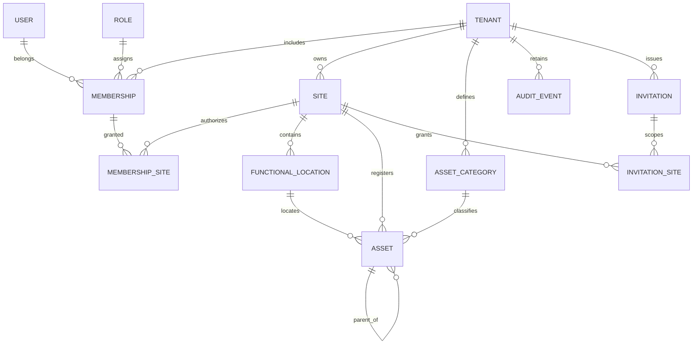

# PostgreSQL schema and migrations



User and Role are global reference/identity entities. Every tenant-owned entity, including the explicit membership/invitation site-through tables, carries tenant_id. UUID keys avoid sequential identifiers but are not an authorization mechanism. Tenant/site/category/asset uniqueness constraints and status/criticality checks are enforced in PostgreSQL. Case-insensitive user-email uniqueness prevents duplicate identities.

Migration `core.0001_initial` creates the foundation entities, indexes and base constraints. `core.0002_roles_scope_constraints` seeds the six fixed role definitions and adds composite foreign keys for membership-site, invitation-site, asset-category, asset-site, asset-location, asset-parent, location-parent and audit-site relationships. These reject cross-tenant/site foreign keys even through direct ORM writes. Migration reversals remove scope FKs before the base tables; do not run them on valuable data without a backup/restore plan.

Asset and reference FKs use PROTECT where historical references must survive. Archive updates the asset's timestamp rather than deleting it. Audit rows preserve before/after registry evidence and reference their tenant/site and actor. Audit rows are append-only through the application, not cryptographically immutable or protected from a privileged database operator.

Transactions include both mutation and audit append. Tenant row locking serializes asset hierarchy changes and permission/grant writes. Invitation acceptance locks its invitation; reset confirmation locks its user before token consumption. No row-level-security policy is claimed: API scope filters plus composite relationship constraints provide the implemented isolation layers.

Verification:

```bash
python manage.py migrate --noinput
python manage.py makemigrations --check --dry-run
python manage.py migrate --check
python manage.py check
pytest --cov=core --cov-report=term-missing
```

Tests create a fresh PostgreSQL test database and apply both migrations; negative cases attempt invalid cross-tenant writes and verify constraint failures/transaction rollback. Seed verification checks two organizations, 12 generated demo accounts, four synthetic assets, private file permissions and idempotence without extra audit rows. Use PostgreSQL 16 and a dedicated test role/database, never production. SQLite is deliberately not supported by the composite FK migration.
